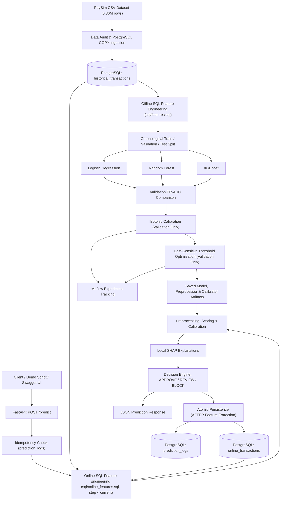

# Real-Time Fraud Detection & Risk Scoring Platform

An end-to-end simulated digital payment fraud detection platform that combines **PostgreSQL behavioural feature engineering**, **chronological machine learning**, **probability calibration**, **cost-sensitive decisioning**, **SHAP explainability**, and a **containerized FastAPI service**.

The platform evaluates incoming transactions against strictly earlier customer history and returns one of three operational decisions:

**`APPROVE` · `REVIEW` · `BLOCK`**

> **Execution & Deployment Status:** Full 6,362,620-row ingestion, EDA notebook execution, 3-model chronological training & evaluation, 18/18 automated Pytest tests, Docker Compose execution (`postgres` + `api`), and AWS ECR image push (`fraud-detection-platform:v1.0.0`, `ap-south-1`) are **completed and verified**. Live AWS EC2 provisioning is **prepared (`deploy/aws/`) but intentionally not provisioned** due to an AWS Free-plan Service Control Policy restriction and to guarantee zero cloud charges.

---

## Table of Contents
- [Project Overview](#project-overview)
- [Business Problem](#business-problem)
- [Project Objectives](#project-objectives)
- [Key Features](#key-features)
- [Technology Stack](#technology-stack)
- [Dataset](#dataset)
- [Exploratory Data Analysis](#exploratory-data-analysis)
- [Behavioural Feature Engineering](#behavioural-feature-engineering)
- [System Architecture](#system-architecture)
- [Machine Learning Pipeline](#machine-learning-pipeline)
- [Model Evaluation](#model-evaluation)
- [Cost-Sensitive Decision Engine](#cost-sensitive-decision-engine)
- [Explainability with SHAP](#explainability-with-shap)
- [API and Real-Time Scoring](#api-and-real-time-scoring)
- [Testing and Validation](#testing-and-validation)
- [Docker and Deployment](#docker-and-deployment)
- [Project Structure](#project-structure)
- [Getting Started](#getting-started)
- [Limitations](#limitations)
- [Future Improvements](#future-improvements)
- [Author](#author)

---

## Project Overview
Traditional transaction-level fraud detection can miss critical behavioural signals when each transaction is evaluated in isolation. This project implements a complete simulated fraud detection workflow that evaluates incoming transactions using historical customer activity, transaction velocity, spending deviations, and transaction characteristics.

The system integrates:
1. **PostgreSQL-based behavioural feature engineering** with strict temporal leakage protection.
2. **Chronological model training and validation** across three classical ML models.
3. **Post-hoc isotonic probability calibration** fitted strictly on Validation data.
4. **Cost-sensitive three-way decisioning** (`APPROVE`, `REVIEW`, `BLOCK`).
5. **Global and local SHAP explainability** returned directly in API responses.
6. **An idempotent FastAPI prediction service** with PostgreSQL event and prediction logging.
7. **Docker Compose orchestration** and AWS deployment preparation.

This project uses the **PaySim synthetic mobile-money dataset** as an end-to-end data engineering, machine learning, and backend portfolio simulation. It is **not** connected to a real banking transaction stream and has **not** been validated for production banking use.

---

## Business Problem
Digital payment fraud detection involves two intertwined challenges:

### 1. Lack of Behavioural Context
Evaluating a single transaction in isolation overlooks:
- Sudden increases in short-term transaction velocity (3-step and 24-step bursts).
- Unusual transaction amounts relative to an account's own historical average and maximum.
- Repeated recent exposure to high-risk transaction types (`TRANSFER`, `CASH_OUT`).
- Cold-start accounts with no prior transaction history.

The platform computes historical behavioural features in PostgreSQL **before** scoring any new transaction.

### 2. Asymmetric Financial Costs
Fraud decisions carry unequal business consequences:

| Decision Error | Potential Consequence |
| :--- | :--- |
| Fraudulent transaction approved (False Negative) | Direct financial loss plus operational penalty |
| Legitimate transaction blocked (False Positive) | Customer friction, declined payments, and potential churn |
| Borderline transaction auto-approved | Elevated fraud exposure without analyst review |

Instead of forcing a single binary threshold, the platform applies a configurable **three-way decision mechanism**:
- **`APPROVE`**: Low-risk transactions processed automatically.
- **`REVIEW`**: Borderline transactions routed for manual scrutiny (subject to review capacity).
- **`BLOCK`**: High-risk transactions stopped immediately.

---

## Project Objectives
- Engineer **16 behavioural features** directly in **PostgreSQL** using CTEs, `LAG()`, and `RANGE` window frames.
- Prevent same-step and future-step temporal data leakage.
- Maintain mathematical parity between offline training (`sql/features.sql`) and online scoring (`sql/online_features.sql`).
- Compare **Logistic Regression**, **Random Forest**, and **XGBoost** on chronological train/validation/test splits using **Validation PR-AUC**.
- Apply **isotonic probability calibration** on Validation data and optimize two cost-sensitive thresholds (`0 < t1 < t2 < 1`).
- Generate global and transaction-level **SHAP explanations**.
- Build an **idempotent FastAPI service** (`/health`, `/model-info`, `/predict`) backed by PostgreSQL and tracked in **MLflow**.
- Validate behaviour with an automated **Pytest** suite and containerize with **Docker Compose**.

---

## Key Features
1. **Temporal Leakage Protection:** PaySim provides hourly `step` integers without reliable within-step ordering. `sql/features.sql` aggregates at `(name_orig, step)` first so `LAG(step)` always references a strictly earlier step, and rolling/lifetime windows end at `1 PRECEDING`. Online queries strictly filter `step < current_step` **before** persisting the incoming event. Post-transaction balances (`newbalanceOrig`, `newbalanceDest`) and target/flag columns (`isFraud`, `isFlaggedFraud`) are excluded from serving features.
2. **Offline / Online Feature Parity:** `sql/features.sql` (offline batch) and `sql/online_features.sql` (online real-time) share identical mathematical definitions and cold-start defaults, verified by automated parity tests.
3. **Cost-Sensitive Three-Way Decision Engine:** Converts calibrated probabilities into `APPROVE`, `REVIEW`, or `BLOCK` using Validation-tuned thresholds and a configurable cost matrix (`configs/cost_matrix.yaml`).
4. **Idempotent Prediction API:**

| Scenario | API Behaviour |
| :--- | :--- |
| New `transaction_id` (or omitted) | Extracts features, scores, explains, decides, persists, and returns HTTP `200` (`idempotent_replay: false`) |
| Existing `transaction_id` with identical payload | Replays stored prediction from `prediction_logs` with HTTP `200` (`idempotent_replay: true`) without double-counting |
| Existing `transaction_id` with conflicting payload | Rejects request with HTTP `409 Conflict` |

5. **SHAP Explainability:** Returns global SHAP summary/bar plots during training and per-transaction `top_explanations` (top 5 by `|SHAP|`), `top_risk_increasing`, and `top_risk_decreasing` in every `/predict` response.
6. **Containerized Execution:** Non-root `Dockerfile` and `docker-compose.yml` running PostgreSQL 16 (private/localhost-bound) and FastAPI with health checks.

---

## Technology Stack

| Category | Technologies |
| :--- | :--- |
| **Programming** | Python 3.11+ |
| **Data & Statistics** | Pandas, NumPy, SciPy |
| **Visualization** | Matplotlib, Seaborn, Jupyter Notebook |
| **Database & SQL** | PostgreSQL 16, CTEs, Window Functions, `LAG()`, `RANGE` Frames, Conditional Aggregation, B-tree Indexes |
| **Database Integration** | SQLAlchemy 2.0, `psycopg` |
| **Machine Learning** | Scikit-learn (`ColumnTransformer`, `LogisticRegression`, `RandomForestClassifier`, `IsotonicRegression`), XGBoost |
| **Explainability** | SHAP (`TreeExplainer` / `LinearExplainer`) |
| **MLOps & Persistence** | MLflow, Joblib |
| **Backend API** | FastAPI, Pydantic, Uvicorn |
| **Testing** | Pytest, HTTPX |
| **Containerization & Cloud** | Docker, Docker Compose, AWS (`ECR`, `EC2`, `IAM`, Private RDS guide) |

---

## Dataset
- **Source:** [PaySim – Synthetic Financial Datasets for Fraud Detection (Kaggle)](https://www.kaggle.com/datasets/ealaxi/paysim1)
- **File:** `PS_20174392719_1491204439457_log.csv`

### Verified Dataset Statistics (`artifacts/reports/paysim_data_quality_report.json`)

| Metric | Verified Value |
| :--- | :--- |
| Total transactions | `6,362,620` |
| Fraudulent transactions (`isFraud = 1`) | `8,213` |
| Non-fraudulent transactions (`isFraud = 0`) | `6,354,407` |
| Fraud rate | `0.1291%` |
| Missing cells | `0` |
| Schema validation | Passed |

### Dataset Characteristics
- `step` represents 1-indexed hourly simulation intervals (`1..743` = ~30 days).
- Valid transaction types (`tx_type`): `CASH_IN`, `CASH_OUT`, `DEBIT`, `PAYMENT`, and `TRANSFER`.
- `nameOrig` and `nameDest` are simulated account identifiers.
- `amount` values are unitless simulator magnitudes—not INR or USD.

---

## Exploratory Data Analysis
Executed end-to-end across all **6,362,620** transactions in [`notebooks/01_eda_paysim.ipynb`](notebooks/01_eda_paysim.ipynb).

### Key Analytical Findings
- **Severe Class Imbalance:** Only `0.1291%` of transactions are fraudulent, making accuracy misleading and motivating **PR-AUC** as the primary metric.
- **Transaction Type Concentration:** Fraud is concentrated in `TRANSFER` and `CASH_OUT`, motivating both one-hot encoding of `tx_type` and the behavioural feature `high_risk_type_count_24_steps`.
- **Heavy-Tailed Amounts:** Transaction amounts span orders of magnitude; `log1p(amount)` and user-relative spending ratios capture anomalous spikes.
- **Temporal Patterns & Statistical Tests:** Examined hourly cycles via `(step - 1) % 24` and verified group differences using Mann-Whitney U and Chi-square tests.

### EDA Visualizations
| Class Imbalance | Fraud Rate by Transaction Type |
| :---: | :---: |
| [artifacts/plots/eda_class_imbalance.png] | [artifacts/plots/eda_tx_type_fraud.png] |

| Amount Distribution (`log1p`) | Temporal Fraud Pattern |
| :---: | :---: |
| [artifacts/plots/eda_amount_distribution.png] | [artifacts/plots/eda_temporal_analysis.png] |

---

## Behavioural Feature Engineering
All **16 model input features** are computed in PostgreSQL (`sql/features.sql` and `sql/online_features.sql`) using CTEs, `LAG()`, and `RANGE` window frames.

### Feature Specification (16 Features)

#### 1. Recency & Transaction Velocity
| Feature | Description |
| :--- | :--- |
| `steps_since_last_tx` | Number of simulation steps since the customer's strictly previous transaction (`step - prev_step`) |
| `tx_count_last_3_steps` | Number of prior transactions in `[step - 3, step - 1]` |
| `tx_count_last_24_steps` | Number of prior transactions in `[step - 24, step - 1]` |

#### 2. Historical Transaction Amounts & Deviation Ratios
| Feature | Description |
| :--- | :--- |
| `tx_amount_sum_last_3_steps` | Sum of prior transaction amounts in `[step - 3, step - 1]` |
| `tx_amount_sum_last_24_steps` | Sum of prior transaction amounts in `[step - 24, step - 1]` |
| `hist_tx_count` | Total number of strictly earlier transactions (`< step`) |
| `hist_avg_amount` | Lifetime historical average transaction amount (`< step`) |
| `amount_vs_user_avg_ratio` | Current `amount / hist_avg_amount` |
| `hist_max_amount` | Lifetime historical maximum transaction amount (`< step`) |
| `amount_vs_user_max_ratio` | Current `amount / hist_max_amount` |

#### 3. High-Risk Transaction History
| Feature | Description |
| :--- | :--- |
| `high_risk_type_count_24_steps` | Count of prior `TRANSFER` and `CASH_OUT` transactions in `[step - 24, step - 1]` |

#### 4. Temporal & Cold-Start Indicators
| Feature | Description |
| :--- | :--- |
| `step_hour_of_day` | Synthetic hour-of-day derived as `(step - 1) % 24` |
| `is_first_tx` | `1` if `hist_tx_count == 0`, else `0` |

#### 5. Current Transaction Attributes
| Feature | Description |
| :--- | :--- |
| `amount` | Current transaction amount (unitless PaySim scale) |
| `log_amount` | `LN(1.0 + amount)` |
| `tx_type` | One-hot encoded transaction type (`PAYMENT`, `TRANSFER`, `CASH_OUT`, `DEBIT`, `CASH_IN`) |

### Temporal Window Design & Cold-Start Defaults
- Rolling windows use `RANGE BETWEEN 3 PRECEDING AND 1 PRECEDING`, `RANGE BETWEEN 24 PRECEDING AND 1 PRECEDING`, and `RANGE BETWEEN UNBOUNDED PRECEDING AND 1 PRECEDING`—strictly excluding the current step and all future steps.
- **Cold-start defaults:** `steps_since_last_tx = -1`, `is_first_tx = 1`, historical counts = `0`, historical amounts/ratios = `0.0`.
- **Excluded leakage fields:** `newbalanceOrig`, `newbalanceDest`, `isFraud`, `isFlaggedFraud`.

---

## System Architecture



### Online Prediction Sequence
1. Client submits a transaction to `POST /predict`.
2. FastAPI validates payload types and constraints via Pydantic.
3. Backend checks `prediction_logs` for `transaction_id` (replays identical request or returns `409 Conflict`).
4. PostgreSQL executes `sql/online_features.sql` across `historical_transactions` and `online_transactions` for strictly earlier steps (`step < current_step`).
5. `ColumnTransformer` preprocesses the 16 features into the canonical 20-column model matrix.
6. Selected `XGBoost` model computes the raw score; isotonic calibrator outputs calibrated `risk_score`.
7. SHAP computes local feature contributions (`top_explanations`, `top_risk_increasing`, `top_risk_decreasing`).
8. Decision Engine assigns `APPROVE`, `REVIEW`, or `BLOCK`.
9. Event and prediction log are persisted atomically to `online_transactions` and `prediction_logs` **after** feature extraction.

---

## Machine Learning Pipeline

### Chronological Data Splits
Transactions are split strictly by `step` (no random shuffling) to prevent future transactions from leaking into past splits. Preprocessing is fitted **only** on Training data.

| Split | Rows | Fraud Cases |
| :--- | :---: | :---: |
| Training | `4,463,587` | `3,643` |
| Validation | `980,416` | `564` |
| Test (Held-Out) | `918,617` | `4,006` |
| **Total** | **`6,362,620`** | **`8,213`** |

### Validation Model Comparison (Primary Metric: PR-AUC)

| Model | Validation PR-AUC | Validation ROC-AUC | Validation Brier Score |
| :--- | :---: | :---: | :---: |
| Logistic Regression (`class_weight="balanced"`) | `0.0053` | `0.9082` | `0.1422` |
| Random Forest (`class_weight="balanced_subsample"`) | `0.2517` | **`0.9417`** | `0.0820` |
| **XGBoost (`scale_pos_weight`, Selected)** | **`0.3246`** | `0.9352` | **`0.0780`** |

**Selected Model:** `xgboost` (`v20261120T175301Z`), selected automatically by highest Validation PR-AUC. Validation isotonic calibration reduced Validation Brier score from `0.07804` to `0.00043`.

---

## Model Evaluation
Evaluated **once** on the untouched chronological Test set (`918,617` rows, `4,006` fraud cases) after model selection, calibration, and threshold optimization were finalized on Validation.

### Held-Out Test Performance (`threshold = 0.20`)

| Metric | Verified Result |
| :--- | :---: |
| **PR-AUC (Primary)** | **`0.3812`** |
| **ROC-AUC** | **`0.9463`** |
| Precision | `0.5635` |
| Recall | `0.3889` |
| F1-Score | `0.4602` |
| False Positive Rate (FPR) | `0.0013` |
| Brier Score (Calibrated) | `0.0032` |

### Test Confusion Matrix (Binary Evaluation at `t2 = 0.20`)

| | Predicted Non-Fraud | Predicted Fraud |
| :--- | :---: | :---: |
| **Actual Non-Fraud** | `913,404` (TN) | `1,207` (FP) |
| **Actual Fraud** | `2,448` (FN) | `1,558` (TP) |

### Test Probability Calibration

| Score Type | Test Brier Score |
| :--- | :---: |
| Raw XGBoost scores | `0.078261` |
| Isotonic-calibrated probabilities | **`0.003241`** |

> **Important Note:** The confusion matrix and binary classification metrics above describe binary classification at `t2 = 0.20` and are distinct from the operational three-way `APPROVE` / `REVIEW` / `BLOCK` decision counts below.

### Evaluation Visualizations
| Validation PR Curves | Validation ROC Curves | Test Calibration Reliability |
| :---: | :---: | :---: |
| [artifacts/plots/validation_pr_curves.png] | [artifacts/plots/validation_roc_curves.png] | [artifacts/plots/test_calibration_plot.png] |

---

## Cost-Sensitive Decision Engine
Calibrated probabilities $p$ are mapped to operational actions using two Validation-optimized thresholds ($0 < t_1 < t_2 < 1$):

| Condition | Operational Decision |
| :--- | :---: |
| $p < t_1$ | **`APPROVE`** |
| $t_1 \le p < t_2$ | **`REVIEW`** |
| $p \ge t_2$ | **`BLOCK`** |

### Validation-Optimized Thresholds (`configs/cost_matrix.yaml`)
- **Review threshold ($t_1$):** `0.05`
- **Block threshold ($t_2$):** `0.20`
- **Maximum review-rate constraint:** `10%` (`0.10`)
- Cost parameters are illustrative unitless modeling assumptions (not INR or USD) and are fully configurable in `configs/cost_matrix.yaml`.

### Held-Out Test Operational Decision Distribution

| Decision | Transactions | Share |
| :--- | :---: | :---: |
| `APPROVE` | `915,615` | `99.67%` |
| `REVIEW` | `237` | `0.03%` |
| `BLOCK` | `2,765` | `0.30%` |
| **Total** | **`918,617`** | **`100.00%`** |

---

## Explainability with SHAP
SHAP provides both global feature importance diagnostics and per-transaction local attributions aligned to the preprocessed feature space.

### Global SHAP Visualizations
| Global SHAP Summary (Beeswarm) | Mean \|SHAP\| Feature Importance |
| :---: | :---: |
| [artifacts/plots/shap_summary.png] | [artifacts/plots/shap_importance_bar.png] |

### Local Explanations
Every successful `POST /predict` response includes:
- `top_explanations`: top 5 features ranked by `|shap_contribution|`.
- `top_risk_increasing`: up to 5 positive SHAP contributors.
- `top_risk_decreasing`: up to 5 negative SHAP contributors.

> **Disclaimer:** SHAP attributions indicate statistical contribution to the model's `risk_score` relative to the background expectation and do **not** prove causation or confirm that a transaction is fraudulent.

---

## API and Real-Time Scoring
Implemented with **FastAPI** and **Pydantic** (`src/api/`):

| Method & Endpoint | Purpose |
| :--- | :--- |
| `GET /health` | Verifies PostgreSQL (`SELECT 1`) and loaded model readiness (`status: "healthy"` / `"degraded"`) |
| `GET /model-info` | Returns selected model, version, calibration status, thresholds, feature schema, and training metadata |
| `POST /predict` | Extracts PostgreSQL historical features, scores, generates local SHAP, applies decision engine, and logs atomically |

### Example `POST /predict` Request
```json
{
  "customer_id": "C_DEMO_USER_01",
  "amount": 1250000.0,
  "tx_type": "TRANSFER",
  "step": 748,
  "transaction_id": "xgb-live-001"
}
```

### Interactive Documentation
Once running locally or via Docker Compose:
- **Swagger UI:** `http://127.0.0.1:8000/docs`
- **ReDoc:** `http://127.0.0.1:8000/redoc`

---

## Testing and Validation
Run the automated test suite inside the project virtual environment:
```powershell
python -m pytest -v
```

**Verified Result:** **`18 / 18` tests passed** (with one non-blocking Starlette `TestClient` deprecation warning).

| Test Module | Coverage |
| :--- | :--- |
| `tests/test_api.py` | `/health`, `/model-info`, `/predict`, cold-start accounts, idempotent replay (`200`), payload conflict (`409`), input validation (`422`), DB/model unavailable (`503`) |
| `tests/test_decision_engine.py` | Exact `APPROVE`/`REVIEW`/`BLOCK` boundaries, invalid threshold rejection, cost calculation math, Validation threshold optimization |
| `tests/test_shap.py` | Preprocessing & feature order enforcement, SHAP output shapes/names, local explanation direction consistency, artifact save/reload parity |
| `tests/test_sql_features.py` | Schema `CHECK`/`UNIQUE` constraints, `LAG()`, 3-step & 24-step boundaries, same-step & future-step exclusion, cold-start defaults, offline vs. online SQL parity |

---

## Docker and Deployment

### Local Docker Compose (Verified)
```powershell
docker compose up --build -d
docker compose ps
```
- `fraud_detection_postgres` (`postgres:16-alpine`): `healthy`, bound to `127.0.0.1` (never exposed publicly).
- `fraud_detection_api`: non-root container serving FastAPI on port `8000` with `/health` health check, verified live against `xgboost (v20261120T175301Z)`.

### AWS Deployment Preparation
- **Completed:** Built and pushed Docker image `fraud-detection-platform:v1.0.0` to private **Amazon ECR** in `ap-south-1`.
- **Prepared (`deploy/aws/deployment_guide.md`, `deploy/aws/user_data.sh`):** Full architecture for Amazon ECR, EC2 (`t3.small`), IAM Instance Profile (no static keys), private PostgreSQL/RDS (`db.t4g.micro`), Security Groups, health checks, and teardown commands.
- **Not Provisioned:** Live EC2 provisioning was blocked by an AWS Free-plan Service Control Policy and intentionally left unprovisioned to guarantee zero cloud charges.

---

## Project Structure
```text
fraud-detection-platform/
├── configs/
│   ├── config.yaml
│   └── cost_matrix.yaml
├── data/
│   ├── raw/
│   └── processed/
├── deploy/
│   └── aws/
│       ├── deployment_guide.md
│       └── user_data.sh
├── notebooks/
│   └── 01_eda_paysim.ipynb
├── scripts/
│   ├── init_db.py
│   ├── load_paysim.py
│   ├── train_pipeline.py
│   └── demo_client.py
├── sql/
│   ├── schema.sql
│   ├── features.sql
│   └── online_features.sql
├── src/
│   ├── api/            (main.py, routes.py, schemas.py)
│   ├── data/           (audit.py, ingestion.py)
│   ├── evaluation/     (calibration.py, cost_matrix.py, decision_engine.py, metrics.py)
│   ├── explainability/ (shap_explainer.py)
│   ├── features/       (extractor.py, preprocessing.py)
│   ├── models/         (registry.py, trainer.py)
│   └── utils/          (config.py, db.py, logging_config.py)
├── tests/
│   ├── conftest.py
│   ├── test_api.py
│   ├── test_decision_engine.py
│   ├── test_shap.py
│   └── test_sql_features.py
├── artifacts/
│   ├── models/
│   ├── plots/
│   └── reports/
├── .env.example
├── .gitignore
├── Dockerfile
├── docker-compose.yml
├── requirements.txt
├── requirements-dev.txt
└── README.md
```

---

## Getting Started

### Prerequisites
- Python 3.11+
- Docker Desktop (with Docker Compose)
- Git
- PaySim CSV from [Kaggle](https://www.kaggle.com/datasets/ealaxi/paysim1)

### Step-by-Step Execution (Windows PowerShell)
```powershell
# 1. Clone and activate virtual environment
git clone [https://github.com/vinayygoudd/fraud-detection-platform.git](https://github.com/vinayygoudd/fraud-detection-platform.git)
cd fraud-detection-platform
python -m venv .venv
.\.venv\Scripts\Activate.ps1
python -m pip install --upgrade pip
python -m pip install -r requirements-dev.txt

# 2. Configure environment variables (set POSTGRES_PASSWORD; never commit .env)
Copy-Item .env.example .env

# 3. Run automated test suite
python -m pytest -v

# 4. Place PaySim CSV at data/raw/PS_20174392719_1491204439457_log.csv
# 5. Start PostgreSQL, initialize schema, and load dataset
docker compose up -d postgres
python scripts/init_db.py
python scripts/load_paysim.py --truncate

# 6. Train, calibrate, tune thresholds, and generate SHAP/MLflow artifacts
python scripts/train_pipeline.py

# 7. Start full Docker Compose stack (PostgreSQL + FastAPI) & run demo client
docker compose up --build -d
docker compose ps
python scripts/demo_client.py --base-url [http://127.0.0.1:8000](http://127.0.0.1:8000)

# 8. Optional: Launch MLflow UI ([http://127.0.0.1:5000](http://127.0.0.1:5000))
mlflow ui --backend-store-uri file:./mlruns --port 5000

# 9. Stop containers cleanly
docker compose down
```

---

## Limitations
1. **Synthetic Dataset:** PaySim is a mobile-money simulation and does not represent genuine production banking data.
2. **Simulated Identifiers & Amounts:** `nameOrig`/`nameDest` are synthetic IDs, and `amount` values are unitless simulator magnitudes.
3. **Hourly Granularity:** `step` represents hourly ticks without sub-hour transaction ordering.
4. **No Live Payment Gateway Integration:** The API simulates real-time scoring and is not validated for production financial operations.
5. **Cloud Deployment Scope:** Docker Compose and AWS ECR image push are verified; live AWS EC2 provisioning was not executed under the AWS Free-plan SCP restriction.

---

## Future Improvements
- Add receiver-side (`nameDest`) graph and mule-account fan-in features in PostgreSQL.
- Implement automated data/concept drift monitoring (PSI, KS tests, rolling PR-AUC alerts).
- Add authentication, API rate limiting, and TLS termination via AWS ALB + ACM for production deployment.
- Evaluate generalization across additional public fraud benchmarks.

---

## Author
**Dudala Vinay Kumar Goud**  
Hyderabad, Telangana, India  
- **GitHub:** https://github.com/vinayygoudd  
- **LinkedIn:** https://linkedin.com/in/vinayygoudd  
- **Portfolio:** https://vinaygoud.github.io  
- **Email:** vinaygoud6281@gmail.com  

*Built as an end-to-end data engineering, machine learning, explainability, and backend portfolio project.*